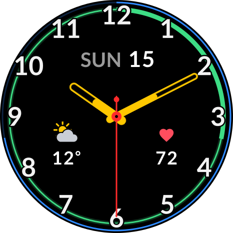

# Dual Rings Analog

An analog watch face for the **Amazfit Active 2 (Round, 466×466)** running Zepp OS.

<p align="center"></p>

## Features

- **Analog hands**: lime hour and minute hands, red second hand.
- **Battery ring** (outer, blue): full at 100%, shrinks counter-clockwise back toward 12 o'clock.
- **Steps ring** (inner, green): every hour numeral is 1,000 steps, and the ring has two laps:
  - 0–12,000 steps fill a thin line.
  - 12,000–24,000 steps fill a thick band on top of it.
- **Three complications** spaced 120° apart:
  - 12 o'clock: weekday and day of month.
  - 4 o'clock: heart rate. Tap it to open the heart rate app.
  - 8 o'clock: weather icon and current temperature. Tap it to open the weather app.
- **Always-on display**: black background with dimmed hands and the date, no seconds hand, no rings.

Supported devices are the Active 2 Round variants in `app.json` (`Milan*` platforms: standard, NFC, 64-bit and Golf editions).

## Install on your watch

Only sideloading is available for now. Follow [Preview on a real watch](#preview-on-a-real-watch) below.

## Project layout

```
app.js                 Zepp OS app entry (empty, required by the framework)
app.json               App manifest: app ID, name, target device, platforms
watchface/index.js     The watch face: widgets, sensors, rings, hands
watchface/layout.js    Shared geometry (radii, positions, hand sizes), used by
                       both the watch face and the asset generator
tools/gen-assets.cjs   Renders every image in assets/ from SVG with sharp
assets/466x466-active-2/
                       Generated PNGs (dial, hands, digits, icons, AOD set).
                       Committed so you can build without regenerating them
preview.png            Generated preview (used in this README)
env.sh                 Optional helper that puts local tools on PATH
```

All graphics are generated in code, so there are no hand-drawn assets. To change a colour, size or position:

- Colours: edit `COL` in `tools/gen-assets.cjs`. The live ring colours are also hardcoded in `watchface/index.js` (`BATTERY_COLOR`, `STEPS_COLOR`); change them in both places.
- Geometry: edit `watchface/layout.js`. Both the watch face and the asset generator read it, so they stay in sync.

## Local development

### Prerequisites

- **Node.js 18+** and **npm**. Tested with Node 22.
- **The Lato font**, which the asset generator uses to render numerals and digits. Without it, sharp silently falls back to another font and the numerals look wrong.
  - Debian/Ubuntu: `sudo apt install fonts-lato`
  - macOS: `brew install --cask font-lato`
- **A Zepp account**, only needed to preview on a real watch.
- Optional: the **Zepp OS Simulator**, available from the [Zepp OS developer site](https://docs.zepp.com/docs/guides/tools/simulator/).

### Setup

```sh
git clone git@github.com:sjuhas1/amazfit2-round-watchface.git
cd amazfit2-round-watchface
npm install
```

The Zepp CLI (`zeus`) is a dev dependency, so after `npm install` you can run it as `npx zeus ...` or through the npm scripts.

If your system has `node` but no `npm`, unpack npm into `.tools/` (gitignored) and run `. ./env.sh`. The script adds `.tools/bin` and `node_modules/.bin` to your `PATH` for the current shell.

### npm scripts

| Command           | What it does                                                                 |
|-------------------|------------------------------------------------------------------------------|
| `npm run assets`  | Regenerates `assets/`, `preview.png` and `store/preview-360.png`.           |
| `npm run build`   | Regenerates the assets, then builds the installable package to `dist/*.zab`. |
| `npm run preview` | Regenerates the assets, then pushes the face to your watch via QR code.     |

### Preview on a real watch

1. Log in once: `npx zeus login`. A browser window opens for your Zepp account.
2. Turn on developer mode in the Zepp phone app: **Profile → Settings → About**, then tap the Zepp logo 7 times.
3. Run `npm run preview` and pick the device when asked. A QR code appears in the terminal.
4. In the Zepp app, open **Profile → Developer Mode → Scan** and scan the code. The face installs on the watch.

### Simulator

Start the Zepp OS Simulator, pick an Active 2 device, then run:

```sh
npx zeus dev
```

The face reloads in the simulator whenever you save a file. Run `npm run assets` first if you changed anything in `tools/` or `layout.js`.

### Forking

`app.json` holds an `appId` registered to the original author. To publish your own version, create an app in the [Zepp developer console](https://console.zepp.com/) and replace `appId` (and `vender`) with your own values.

## Notes and gotchas

- `ONAL_AOD` and `hightCost` look like typos, but they are the actual identifiers in the Zepp OS API and must stay as they are.
- The rings are full-circle `ARC_PROGRESS` widgets, and only their `LEVEL` property is updated. Updating them with a partial `prop.MORE` made them vanish on the real watch, even though the simulator showed them fine.
- Sensor listeners are attached only while the face is on screen (`WIDGET_DELEGATE` resume/pause) to save battery.

## License

[MIT](LICENSE) © 2026 Sandor Juhasz.

The digits and numerals in `assets/` are rendered from the [Lato](https://www.latofonts.com/) font, which is licensed under the SIL Open Font License 1.1. The OFL allows images rendered with the font to be used under any license. The Zepp OS tooling (`@zeppos/zeus-cli`, `@zeppos/device-types`) is ISC-licensed and is only a development dependency, so none of it ships in the watch face.
